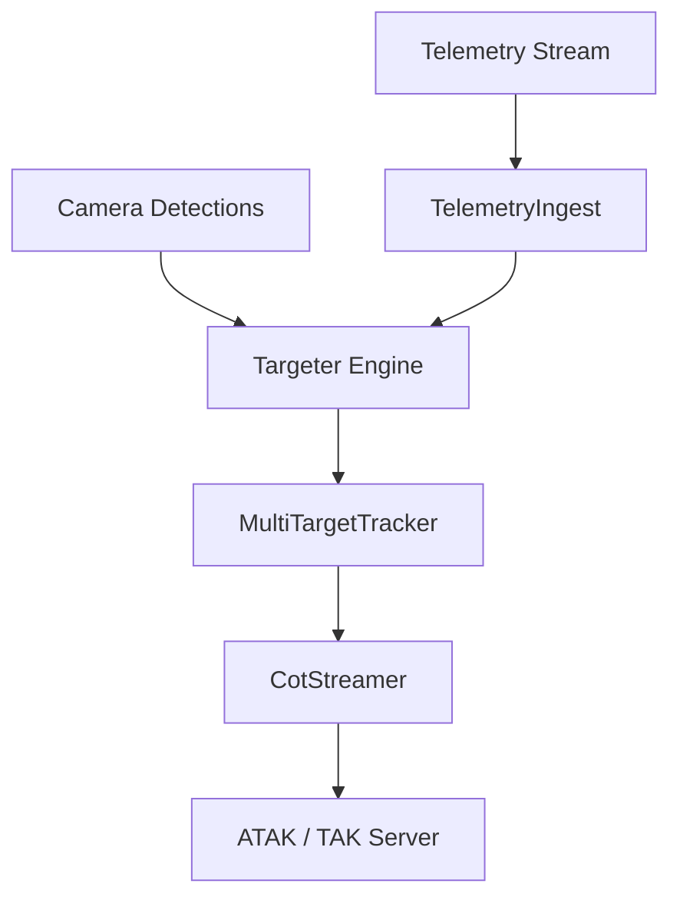

# Airborne CoT Relay

Airborne sensor-to-TAK Cursor-on-Target relay pipeline.

## Status

The library modules are implemented and covered by unit tests.

The `airborne-cot-relay` binary runs a simulated flight path in mock mode by default, transmitting Cursor-on-Target (CoT) events over UDP to the configured broadcast address (`127.0.0.1:6969` by default). Live mode binds the telemetry listener socket and awaits sensor input.

## System Architecture



## Mathematical Formulation

1. **Ray Back-Projection:**
   Inverts pinhole intrinsics to camera frame unit vector.

2. **Ground Intersection:**
   Transforms ray to ENU and computes ground plane intercept.

3. **Covariance Estimation:**
   Projects angular uncertainty into CE90/LE90 error ellipses.

## Usage Instructions

```bash
cargo run --bin airborne-cot-relay -- --help
cargo run --bin airborne-cot-relay -- --dry-run
cargo run --bin airborne-cot-relay -- --mock
cargo run --example mock_flight_mission
cargo test --all-targets
cargo test --all-targets --all-features
```

### Features and Ingest Adapters

- **Lean Core (default):** Core relay binary and runtime pipeline with zero external dependencies beyond `stm32-navcore` and `sightline-cot`.
- **Experimental Feature (`--features experimental`):** Gated protocol extensions including telemetry recorders, compression, failover router, and schedulers.
- **Zero-Dependency Ingest Adapters:**
  - `ingest::mavlink_udp`: MAVLink v2 UDP telemetry source (`GLOBAL_POSITION_INT` & `ATTITUDE`) with X.25 CRC-16.
  - `ingest::serial_cobs`: Streaming COBS reader decoding `stm32_navcore::protocol::NavTelemetry` over byte streams.
  - `ingest::json_udp`: UDP JSON-lines detection parser extracting normalized bounding boxes and classifications.

### CLI Arguments

| Argument | Behavior |
| --- | --- |
| `--mock`, `-m` | Run a simulated flight path and send CoT events to destination (default) |
| `--live`, `-l` | Listen for live UDP telemetry and detection streams, relaying CoT events subject to StaleGate |
| `--dry-run` | Resolve mission mode and configuration, then exit immediately |
| `--help`, `-h` | Print usage text and exit with status 0 |
| `--version`, `-V` | Print version and exit with status 0 |

### Exit Codes

- `0`: Success (mission completed, help or version displayed, dry-run resolved)
- `2`: Invalid CLI argument or configuration error
- `3`: Socket bind failure (e.g., telemetry address already in use)

See [docs/architecture.md](docs/architecture.md) for module responsibilities and [docs/operations.md](docs/operations.md) for configuration, environment variables, failure modes and exit codes.
