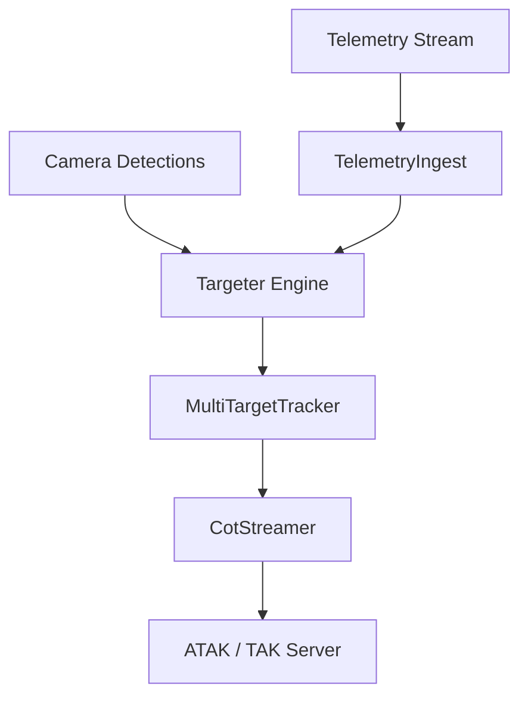

# Airborne CoT Relay

Zero-allocation airborne sensor-to-TAK Cursor-on-Target relay pipeline.

## System Architecture



## Mathematical Formulation

1. **Ray Back-Projection:**
   Inverts pinhole intrinsics to camera frame unit vector.

2. **Ground Intersection:**
   Transforms ray to ENU and computes ground plane intercept.

3. **Covariance Estimation:**
   Projects angular uncertainty into CE90/LE90 error ellipses.

## Usage Instructions

```bash
cargo run --bin airborne-cot-relay -- --help
cargo run --example mock_flight_mission
cargo test --all-targets
```
