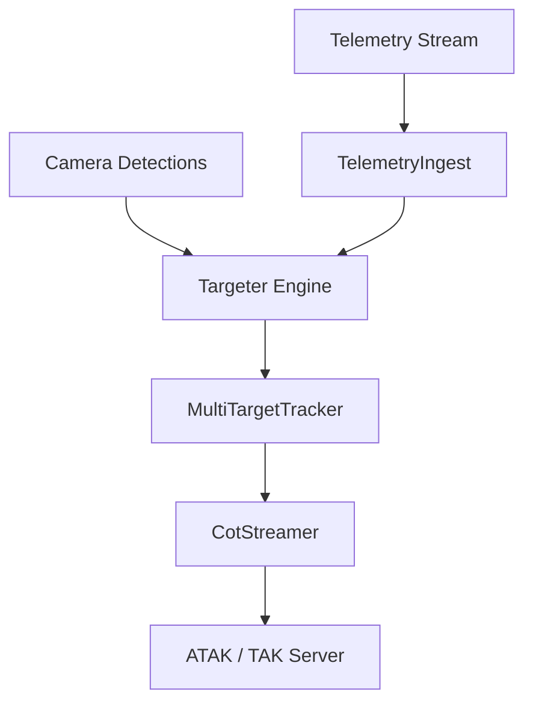

# Airborne CoT Relay

Airborne sensor-to-TAK Cursor-on-Target relay pipeline.

## Status

The library modules are implemented and covered by unit tests.

The `airborne-cot-relay` binary is still a placeholder. It prints fixed messages for each mode and does not open sockets or read telemetry yet.

## System Architecture

The diagram shows the intended data flow. The binary does not connect these stages yet.



## Mathematical Formulation

1. **Ray Back-Projection:**
   Inverts pinhole intrinsics to camera frame unit vector.

2. **Ground Intersection:**
   Transforms ray to ENU and computes ground plane intercept.

3. **Covariance Estimation:**
   Projects angular uncertainty into CE90/LE90 error ellipses.

## Usage Instructions

```bash
cargo run --bin airborne-cot-relay -- --help
cargo run --example mock_flight_mission
cargo test --all-targets
```

The binary reads only its first argument:

| Argument | Behavior |
| --- | --- |
| `--mock`, `-m`, or any unknown value | Print the simulated 60-second flight message (default) |
| `--live`, `-l` | Print the live listening notice |
| `--help`, `-h` | Print usage and exit with status 0 |

